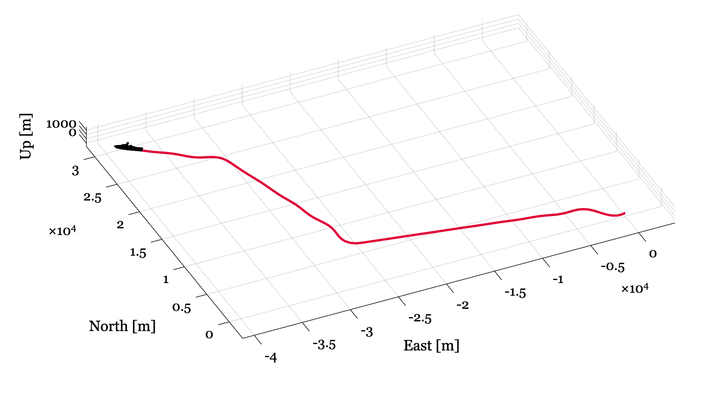

# TTK4190 – Guidance, Navigation and Control: Assignment 2 & 3

MATLAB simulation of a 161 m container ship following a waypoint path through the
Trondheimsfjord, for NTNU's course **TTK4190 Guidance, Navigation and Control of Vehicles**.
The project covers ship modelling, heading autopilot design, path-following guidance and
state estimation under current, wind and sensor noise.

<p align="center">
  
  <br><em>Simulated trajectory (red) against the straight-line waypoint path (blue).</em>
</p>

<p align="center">
  
  <br><em>3-D visualization of the same run, made with <code>flypath3d</code>.</em>
</p>

## What's implemented

| Area | Content | Files |
| --- | --- | --- |
| **Ship model** | 3-DOF container ship with rudder and propeller dynamics, ocean current and wind loads | `ship.m` |
| **Linear model** | First-order Nomoto model (T, K) linearized at the design speed | `nomoto_first_order.m` |
| **Heading control** | 3rd-order reference model + PID autopilot from pole placement (Fossen Alg. 15.1), anti-windup on rudder saturation | `ref_model.m`, `pid_desing_nomoto.m`, `PID_heading.m` |
| **Speed control** | Open-loop (feed-forward) propeller speed from the steady-state surge model | `open_loop_speed_control.m` |
| **Guidance** | Waypoint switching with a circle of acceptance, cross-track error, LOS and **integral LOS (ILOS)** laws, crab-angle compensation | `guidance.m`, `WP_selector.m`, `crossTrackError.m`, `LOS_guidance.m`, `ILOS_guidance.m` |
| **Estimation (KF)** | Discrete Kalman filter on `[ψ, r, b]` (yaw, yaw rate, rudder bias) from noisy compass data, with NIS/NEES consistency checks | `discrete_system.m`, `KF.m`, `analysis.m` |
| **Estimation (ESKF)** | Error-state Kalman filter combining an IMU with GNSS position and compass heading, at multiple rates | `main_ESKF.m` |

## Repository layout

```
main.m                      Main simulation: guidance + autopilot + Kalman filter
main_ESKF.m                 Same scenario, using the inertial error-state KF as the navigation system
analysis.m                  Observability check and discretization of the KF model
*.m                         Model, guidance, control and estimation functions (see table above)
flypath3d_v3/               3-D trajectory visualization toolbox and ship models
pathplotter and waypoints/  Waypoints (WP.mat) and map plotter (pathplotter.m)
imgs/                       Result figures
simdata_ESKF.mat            Saved ESKF simulation output
GNC_Ass2_3.pdf              Report
```

## Running

Requirements:
- MATLAB with the Control System Toolbox (`c2d`, `obsv`). The Statistics Toolbox is optional: without it, the χ² bounds are hard-coded.
- The [MSS toolbox](https://github.com/cybergalactic/MSS) on the MATLAB path. It provides `ssa`, `rk4`, `wageningen`, `invQR`, `gravity`, `ins_euler`, …

```matlab
main          % KF-based simulation: plots of states, estimates, NIS/NEES, 3-D flypath and map path
main_ESKF     % ESKF-based simulation
```

Main settings at the top of `main.m`:

| Variable | Meaning |
| --- | --- |
| `current_on` | Turn the ocean current (`Vc`, `beta_Vc`) on or off |
| `crab_compensation` | Subtract the crab angle from the desired course |
| `feedback` | Autopilot feedback source: `'true'`, `'noisy'` or `'kf'` |
| `Vw`, `beta_Vw`, `t_wind` | Wind speed, direction and start time |
| `law` (in `guidance.m`) | `'ilos'` or plain LOS |

## Author

Antonio Zerbato, Robotics Engineering, NTNU.
